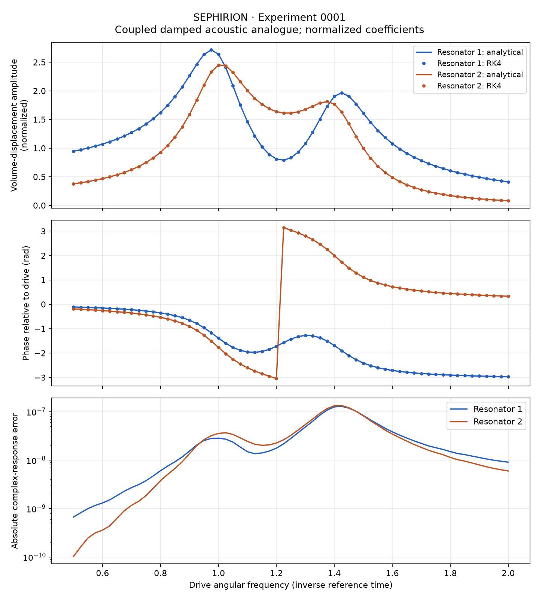

# Experiment 0001: measured reference run

Run date: 2026-11-17. Runtime: SBCL 2.6.9. No external Lisp dependencies.

## Result

All 2022 automated assertions passed (including 2000 per-step passive-energy checks).
The 61-frequency sweep had maximum absolute complex-amplitude error **1.3382302e-07**
against the analytical solution. Complex error tests amplitude and phase together.

| Observable | Measured value |
| --- | --- |
| Resonator 1: largest sampled amplitude | 2.71521987 at omega = 0.975 |
| Resonator 2: largest sampled amplitude | 2.45145170 at omega = 1.000 |
| Every-tick trace rows (including initial state) | 12548 |
| Trace final time | 250.27024143 |

The sampled maxima are grid measurements, not fitted peak frequencies.



## Reproduction

From the repository root:

```sh
sbcl --script scripts/test.lisp
sbcl --script scripts/experiment-0001.lisp
# Optional plot rendering requires Python and matplotlib:
python scripts/plot-experiment-0001.py
```

See [the model specification](../../docs/ACOUSTICS.md) for all coefficients, equations,
measurement windows, units, and limitations. Raw observations: [sweep.csv](sweep.csv)
and [trace.csv](trace.csv). The trace includes the entire settling interval.

This is numerical agreement with a linear lumped acoustic model. It is not a
measurement of physical hardware, spatial sound propagation, recursive realms,
or emergent computation.
